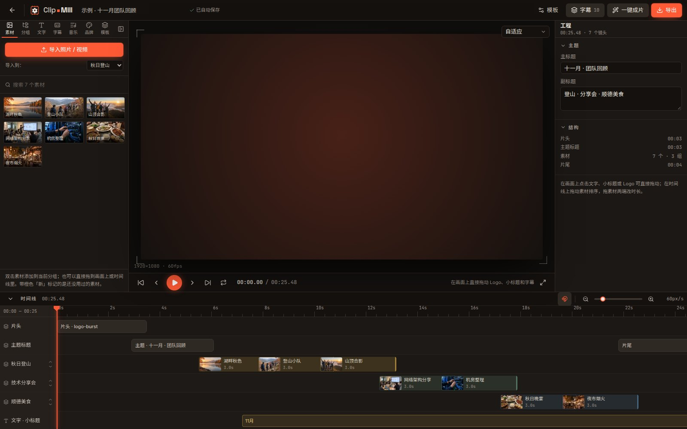

# ClipMill · 固定模式视频自动剪辑

> 拖进照片，剩下的交给流水线。

ClipMill 是一个**完全在浏览器里运行**的自动剪辑工具，专门处理"每周/每月都要做一遍"的固定套路视频：片头动画 → 主题大标题 → 按主题分组的照片 → 片尾动画。

你只需要把照片按主题分好组、把 Logo 和片头片尾配一次，以后每次导入新照片，点一下「一键成片」，就能导出 **60 帧 1080P 或 4K** 的 MP4。所有素材只保存在你自己的电脑浏览器里（IndexedDB），不上传任何服务器。




## 功能一览

| # | 需求 | ClipMill 的实现 |
|---|------|----------------|
| 1 | Logo 贴在左上角，除去开头结尾 | Logo 角标只在「片头结束 → 片尾开始」之间显示，位置、大小、边距、不透明度可调，也能直接在画面上拖动 |
| 2 | 固定开头结尾动画 | 内置 5 种程序化片头、4 种片尾模板（会使用你的 Logo、品牌名、标语），也可以上传自己的片头/片尾视频 |
| 3 | 开头后显示主题大标题 | 全屏大标题场景，4 种版式，背景可选「首图虚化 / 纯色 / 渐变」，字号、时长可调 |
| 4 | 图文混合、分组小标题 | 照片和视频可以混排；素材按主题分组，播放时左下角自动出现该组的主题小标题（可自由拖动，每组位置可单独保存） |
| 5 | 一键随机过渡 | 一键给全部素材随机过渡，可选「柔和 / 动感 / 全部」风格池，相邻镜头不会连续重复；也能只作用于选中的素材 |
| 6 | 自由增加其他小标题 | 文字轨道，可添加任意文字（如「11月」），设置起止时间、位置、样式和动画 |
| 7 | 时间线与轨道 | 片头 / 主题 / 每个分组 / 文字 / 顶部字幕 / 底部字幕 / 音乐 / 片尾 / Logo 都是独立轨道，支持缩放、拖动排序、拖两端改时长、播放头吸附、撤销重做 |
| 8 | 60 帧流畅、照顾负载 | 画布按需重绘、暂停时不空转；预览只用低分辨率代理图 + LRU 缓存；播放头用 DOM 变换不走 React；预览分辨率可自适应 |
| 9 | 导出 60 帧 1080P / 4K | 基于 WebCodecs 硬件编码，H.264 / H.265 / AV1 / VP9 自动检测；可流式直接写入硬盘，4K 长片也不怕撑爆内存 |
| 10 | .lrc / .srt 字幕、双语 | 导入 .lrc / .srt，自动识别双语并拆成「顶部 + 底部」两条轨；支持整体时间平移、样式模板 |
| 11 | 多种模板 | 过渡 20 种、文字样式 8 套、文字动画 8 种、标题版式 4 种、片头 5 种、片尾 4 种 |
| 12 | 开源 | MIT 协议，公开仓库 [unkaku-1/clipmill](https://github.com/unkaku-1/clipmill)，README + 一键部署脚本（Docker / GitHub Pages） |

## 快速开始

### 方式一：一键部署（Docker，推荐给自己或 NAS）

需要先安装 Docker（绿联 NAS 的「Docker」应用、Docker Desktop 都可以）。

```bash
# Linux / macOS
./deploy.sh

# Windows PowerShell
.\deploy.ps1
```

脚本会构建镜像并在 `http://localhost:8080` 启动（端口可用 `CLIPMILL_PORT` 修改）。停止用 `./deploy.sh down`，看日志用 `./deploy.sh logs`。

也可以手动：

```bash
docker compose up -d --build
```

> **关于 HTTPS**：浏览器只允许在「安全上下文」（HTTPS 或 localhost）里使用 WebCodecs。用 `http://localhost:8080` 打开可以正常导出；如果从局域网其他电脑用 `http://NAS-IP:8080` 访问，可以编辑但**不能导出**。想让局域网也能导出，请用 Caddy / Traefik / Nginx 加证书反向代理到本容器。

### 方式二：本地开发

```bash
pnpm install
pnpm dev        # http://localhost:3000
pnpm build      # 产物在 dist/，可直接放到任意静态服务器
```

需要 Node.js 22+ 和 pnpm。构建产物是纯静态文件，Nginx、Caddy、Vercel、Netlify、GitHub Pages 都能直接托管。

### 方式三：GitHub Pages（免服务器、自动 HTTPS）

```bash
./deploy-pages.sh        # 构建并推送到 gh-pages 分支
```

然后到仓库 **Settings → Pages**，Source 选 **Deploy from a branch**，分支选 `gh-pages` / `(root)`。之后访问 `https://<用户名>.github.io/<仓库名>/` 即可，HTTPS 环境可以直接导出视频。

如果更喜欢用 GitHub Actions，把 `docs/github-actions-pages.yml` 复制到 `.github/workflows/pages.yml`，再把 Pages 的 Source 改成 **GitHub Actions** 就行。

## 怎么用

1. **配置一次品牌**（左侧「品牌」面板）：上传 Logo，填品牌名和标语，选片头和片尾模板、配色。点「保存为模式」并设为默认，以后新建工程会自动套用——这就是「固定模式」。
2. **新建工程**：填主题大标题和副标题。
3. **导入照片**：在「素材」面板拖入或选择图片/视频，它们会进入当前选中的分组。
4. **建分组**：「分组」面板里新建主题（比如「秋日登山」「技术分享会」），组名就是左下角的小标题。
5. **加字幕**（可选）：「字幕」面板导入 `.lrc` 或 `.srt`，双语文件会按第一行/第二行自动分到顶部和底部。
6. **加音乐**（可选）：「音乐」面板添加背景音乐，点「适配音乐时长」会自动均分每张图片的时长，让视频刚好等于歌曲长度。
7. **一键成片**：顶栏点「一键成片」，随机过渡 + 随机运镜一次搞定。
8. **微调**：在时间线上拖动素材排序、拖两端改时长；在画面上直接拖动小标题、文字、Logo 和字幕。
9. **导出**：点「导出」，选 1080P 或 4K（固定 60fps），建议选「直接写入硬盘」。

### 快捷键

| 按键 | 作用 |
|------|------|
| 空格 | 播放 / 暂停 |
| ← / → | 上一帧 / 下一帧（按住 Shift 每次 10 帧） |
| Home / End | 跳到开头 / 结尾 |
| Ctrl/Cmd + Z / Shift+Z | 撤销 / 重做 |
| Ctrl/Cmd + D | 复制选中的素材 |
| Delete / Backspace | 删除选中项 |
| Ctrl + 滚轮 | 缩放时间线 |

## 导出说明

- 导出为 MP4（H.264 兼容性最好；H.265 体积更小；AV1 编码更慢但更省空间）。可用的编码器取决于你的显卡和浏览器，导出窗口会自动检测并列出。
- 建议使用最新版 **Chrome / Edge 桌面版**。Safari 对 WebCodecs 的支持有限，Firefox 部分编码器不可用。
- 4K 60fps 对显卡有要求，导出速度取决于硬件编码器；导出期间请保持标签页在前台。
- 选择「直接写入硬盘」时，浏览器会弹出保存对话框，画面帧会边渲染边写入文件，长视频也不会占用大量内存。

## 数据与隐私

- 照片、视频、音乐和工程都保存在当前浏览器的 **IndexedDB** 里，不会上传到任何服务器。
- 换电脑、换浏览器或清理浏览器数据之前，请先把需要的成片导出。
- 工程会自动保存；「工程」列表里可以复制或删除。

## 技术架构

```
src/
├── engine/            渲染与导出引擎（与 UI 解耦，预览和导出共用同一套绘制代码）
│   ├── timeline.ts    时间线布局：把分组/片段/过渡计算成带重叠区间的轨道
│   ├── render.ts      逐帧渲染：画面层 + 过渡 + Logo + 小标题 + 文字 + 字幕
│   ├── transitions.ts 20 种过渡效果（遮罩、变形、模糊、幻灯片…）
│   ├── scenes.ts      片头 / 片尾 / 主题大标题动画
│   ├── text.ts        文字排版、样式模板、动画（带位图缓存）
│   ├── sources.ts     预览帧供给：代理图 LRU、视频 <video> 同步、预取
│   ├── export.ts      WebCodecs 编码 + Mediabunny 封装 MP4 + 音频混音
│   ├── importer.ts    导入：生成代理图、缩略图、模糊背景、音频波形
│   └── automation.ts  一键成片、随机过渡/运镜、适配音乐时长
├── components/
│   ├── editor/        编辑器框架、预览舞台、属性面板、各功能面板
│   └── timeline/      多轨时间线（虚拟化、拖拽、吸附、缩放）
├── store/editor.ts    工程状态（immer 撤销重做、自动保存）
├── db/                IndexedDB：工程、素材 Blob、模式预设
├── subtitles/         LRC / SRT 解析与双语拆分
└── lib/               字体、工具、能力检测、示例工程
```

几个关键设计：

- **预览和导出一致**：两边都调用 `renderFrame()`，预览只是用低分辨率画布，避免"预览好看导出翻车"。
- **60 帧的关键**：暂停时只在状态变化时重绘；播放时只重绘画布，播放头位置用 `transform` 直接改 DOM；时间线不因播放头移动而重新渲染。
- **内存友好**：原图只在导入时读取一次生成代理图；预览只解码播放头附近的图片，超出 LRU 容量自动释放；视频用池化的 `<video>` 元素同步播放。
- **导出不卡界面**：编码在 `VideoEncoder` 的硬件管线里进行，渲染帧逐个送入，进度和速度实时显示，可随时取消。

## 常见问题

**Q：导出按钮是灰色的 / 提示不支持？**
A：请用 HTTPS 或 localhost 打开，并使用桌面版 Chrome/Edge。局域网 HTTP 访问只能编辑不能导出。

**Q：HEIC 照片能导入吗？**
A：浏览器能否解码 HEIC 取决于系统，iPhone 用户建议先在相册里转成 JPG，或使用"兼容性最佳"的传输格式。

**Q：视频素材的原声会保留吗？**
A：会。视频片段的原声可以单独调音量或静音，导出时会和背景音乐混合。

**Q：能自定义片头动画吗？**
A：可以上传自己的片头/片尾视频（MP4，H.264），它会替代模板动画。

**Q：工程数据存在哪里？会丢吗？**
A：存在浏览器 IndexedDB。清理浏览器数据会删除工程，请定期导出成片。

## 开发

```bash
pnpm dev       # 开发服务器
pnpm check     # TypeScript 类型检查
pnpm build     # 生产构建
```

欢迎提交 Issue 和 PR。新增过渡效果只需要在 `src/engine/catalog.ts` 注册，并在 `src/engine/transitions.ts` 里实现绘制函数；新增文字样式同理。

## 致谢

- [Mediabunny](https://mediabunny.dev/) —— 浏览器端 MP4 封装与解码
- [React](https://react.dev/) · [Vite](https://vite.dev/) · [Tailwind CSS](https://tailwindcss.com/) · [Zustand](https://zustand.docs.pmnd.rs/) · [Immer](https://immerjs.github.io/immer/)
- [Fontsource](https://fontsource.org/) 提供的开源字体（思源黑体/宋体、马善政、站酷等）

## License

[MIT](LICENSE) © 2026 ClipMill contributors
